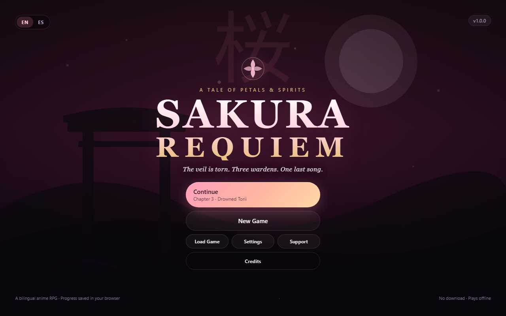
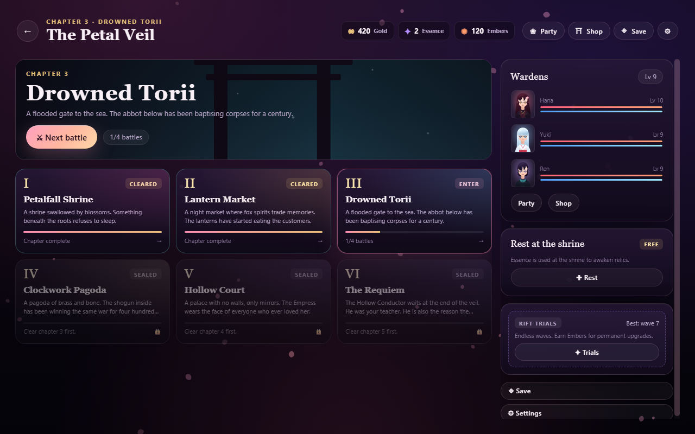
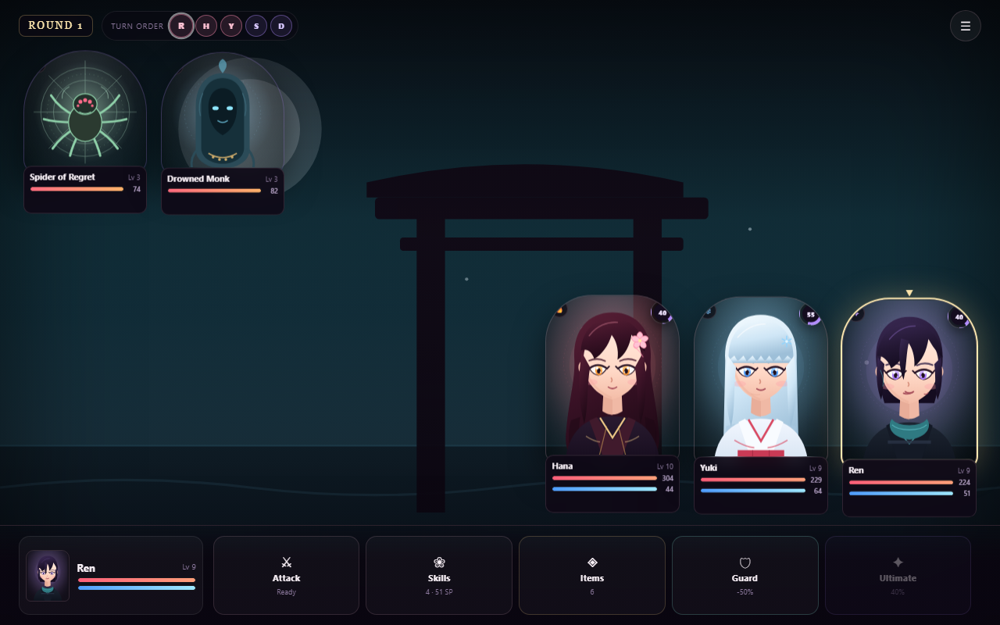
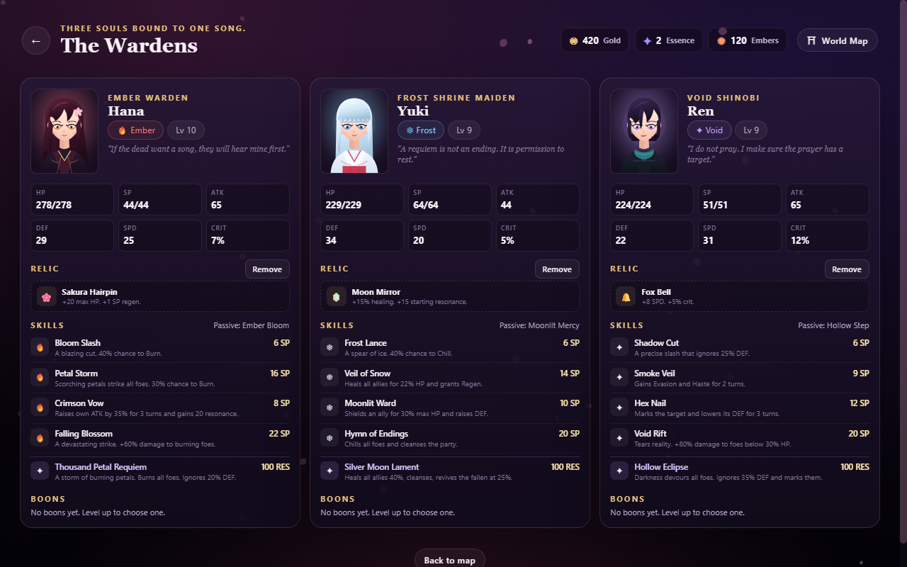
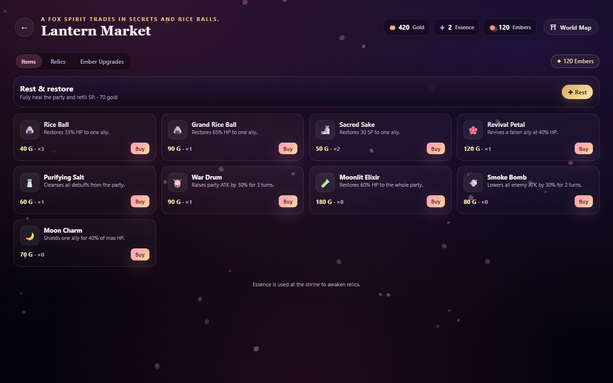
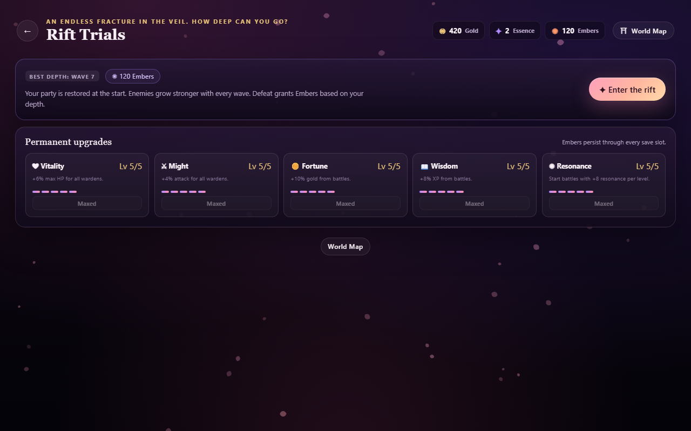

# Sakura Requiem

**A bilingual (English / Español) turn-based anime RPG that runs entirely in your browser.**

Three wardens. One last song. The dead are listening.

[](#play-it)
[](#localization)
[](#project-structure)



Sakura Requiem is a complete, original short JRPG: six chapters, 24 battles,
phased bosses, elemental weaknesses, status effects, ultimates, relics, boons, a
shop, an endless roguelite mode and three save slots. It is built with plain
HTML, CSS and JavaScript — no framework, no build step, no external assets, no
trackers.

---

## Play it

### Locally

Because the game uses classic `<script>` tags (not ES modules), you can simply
open `index.html` in a modern browser. For the best experience — and to make
service-worker/PWA features behave — serve the folder over HTTP:

```bash
# Python 3
python -m http.server 8123

# or Node
npx serve .
```

Then open <http://localhost:8123>.

### Publish it

The game is a static site. Any static host works:

- **GitHub Pages** — push to `main`, then *Settings → Pages → Source: GitHub
  Actions*. The included workflow in `.github/workflows/pages.yml` deploys the
  repository root automatically. `.nojekyll` is already present.
- **itch.io** — zip the folder, upload it as an HTML game, tick *"This file will
  be played in the browser"* and set the viewport to 1280×720 (the game is
  responsive).
- **Netlify / Cloudflare Pages / Vercel** — drag and drop the folder or connect
  the repository. No build command; publish directory is `/`.

---

## Features

- **Six chapters, 24 encounters.** Three regular battles and one boss per
  chapter, each with its own hand-drawn SVG location.
- **Three playable wardens** with distinct elements and roles:
  - **Hana** — Ember bruiser, burns and executes.
  - **Yuki** — Frost healer, shields and cleanses.
  - **Ren** — Gale rogue, speed, crits and debuffs.
- **Turn-based combat** with a visible turn order, elemental weakness/resistance,
  guarding, items, status effects (burn, freeze, bleed, poison, silence, buffs
  and debuffs), and a shared **resonance** gauge for ultimates.
- **Phased bosses** that change tactics and gain new moves at HP thresholds.
- **Progression:** levels, skill unlocks, 20 boons, 13 relics, 9 items, a shop,
  and permanent meta upgrades bought with Embers.
- **Rift Trials** — an endless wave mode with escalating enemies, bonus Embers
  and a persistent best-wave record.
- **Three save slots** with autosave, manual save, **export/import save codes**,
  play-time tracking and an ending flag.
- **Bilingual UI and story** (English / Español), switchable at any time,
  including mid-battle. The choice is remembered.
- **Accessibility & comfort:** reduced motion, text speed, volume sliders,
  keyboard-friendly dialogue, large touch targets, responsive layout from phone
  to desktop.
- **Original presentation:** every character, enemy, background and icon is
  generated as inline SVG; music and SFX are synthesised with the Web Audio API.
  No fonts, images, audio files or CDNs are downloaded.
- **Privacy-first:** no accounts, no cookies, no trackers, no network requests.
  Progress lives in `localStorage`. See [PRIVACY.md](PRIVACY.md).
- **Monetization-ready:** an optional cosmetic *Moonlight Supporter Pack* and
  donation/store placeholders, with ads and analytics disabled by default. See
  [MONETIZATION.md](MONETIZATION.md).

---

## Screenshots

| Exploration | Combat |
| --- | --- |
|  |  |

| Party & builds | Shop |
| --- | --- |
|  |  |

| Rift Trials | Español |
| --- | --- |
|  |  |

---

## How to play

| Action | Mouse / touch | Keyboard |
| --- | --- | --- |
| Advance dialogue | Click / tap | `Space` or `Enter` |
| Skip dialogue | *Skip* button | `Esc` |
| Choose a command | Click a command button | — |
| Pick a target | Click the highlighted unit | — |
| Cancel targeting / submenu | *Back* button | `Esc` |
| Open battle menu (log, settings, retreat) | ☰ button | — |

**Combat tips**

- Hit elemental weaknesses for bonus damage; the target hint shows the matchup.
- **Guard** reduces incoming damage and restores a little SP.
- Ultimate skills need 100 resonance. Attacking, taking hits and some relics
  build it faster.
- Status effects matter. Burn and bleed stack pressure; freeze can skip a turn;
  Purifying Salt cleanses the whole party.
- Bosses change behaviour below 50% HP. Save an ultimate for the second phase.
- Between battles you can rest (once per chapter), shop, re-equip relics and
  spend boons. Boons are permanent for the run.

### Saving

- The game autosaves after battles and story scenes.
- Use **Save** on the map to write to any of the three slots.
- **Export** produces a text code you can paste into **Import** on another
  device or browser.
- **Settings → Erase all progress** wipes saves, meta progression and settings.

---

## Localization

Every string — UI, story, skill names, item descriptions, enemy names and the
ending — exists in English and Spanish in `js/i18n.js` and `js/data.js`. Language
can be changed from the title screen or Settings; the preference is stored
locally.

To add a language:

1. Add a dictionary in `js/i18n.js` following the `en` / `es` shape.
2. Allow the new code in `SR.setLang`.
3. Translate the `{ en, es }` objects in `js/data.js` (story, names, descriptions).
4. Add the language button to the title/settings UI.

---

## Project structure

```
.
├── index.html                 # Shell, meta tags, script order
├── manifest.webmanifest       # PWA metadata
├── css/style.css              # Complete responsive UI
├── js/
│   ├── config.js              # Support links, premium codes, ads, analytics
│   ├── i18n.js                # EN/ES dictionaries and helpers
│   ├── data.js                # Heroes, enemies, chapters, items, relics, boons
│   ├── art.js                 # Procedural SVG characters, enemies, scenes
│   ├── audio.js               # Web Audio music and SFX
│   ├── engine.js              # Pure battle engine and balance math
│   ├── save.js                # Slots, meta progression, shop, premium, trials
│   ├── ui.js                  # Modals, settings, toasts, save slots, support
│   ├── battle.js              # Battle UI controller
│   ├── screens.js             # Screen renderers and dialogue player
│   └── app.js                 # Router, game flow, boot
├── assets/                    # SVG icons + PNG social card
├── docs/screenshots/          # README screenshots
├── .github/workflows/pages.yml
├── LICENSE                    # MIT for code, assets reserved
├── MONETIZATION.md
└── PRIVACY.md
```

There is no package manager, bundler or server dependency. Edit a file, refresh
the browser.

### Architecture notes

- Everything hangs off the global `window.SR` namespace.
- `js/engine.js` is UI-free and deterministic enough to simulate balance; the UI
  in `js/battle.js` only renders state and forwards actions.
- Screens are functions that return HTML plus a mount function; `SR.App.go()`
  handles transitions and lifecycle cleanup.
- Saves are plain JSON with a versioned key (`sr.saves.v1`). The `normalizeRun`
  function migrates missing fields, so adding new run fields is safe.
- All art is generated at runtime from `SR.Art`; there are no image files to
  load. Audio starts only after a user gesture, as browsers require.

---

## Balance

The campaign is tuned to be completable without grinding:

- Chapters 1–5 clear reliably with normal play and no shop abuse.
- The final boss is the difficulty spike; it is beatable at the level the game
  naturally provides, but punishes ignoring guard, healing and phase changes.
- Rift Trials are endless and intentionally escalate past the campaign curve.

The engine is simulation-friendly. If you change stats in `js/data.js`, you can
run headless simulations against `SR.Engine` to sanity-check clear rates before
shipping.

---

## Customizing

- **Difficulty:** tweak enemy `base`/`growth` values in `js/data.js`, or the
  level curve in `js/engine.js`.
- **Content:** add a chapter to `SR.DATA.chapters` with `encounters`, `boss`,
  `intro`, `bossIntro` and `outro`. The map and progression pick it up
  automatically.
- **Art:** `js/art.js` exposes `SR.Art.hero(id, opts)`, `SR.Art.enemy(id)` and
  `SR.Art.scene(id)`. All return SVG strings.
- **Music:** themes are generated in `js/audio.js`; adjust scales, tempo and
  instruments there.
- **Monetization:** see [MONETIZATION.md](MONETIZATION.md).

---

## Browser support

Tested in current Chromium-based Edge/Chrome. The game targets evergreen
browsers with support for ES2020, CSS custom properties, `dvh` units, SVG and
the Web Audio API. It runs from `file://` or any static host. There is no
service worker, so offline play relies on the browser cache; keep a local copy
of the folder if you need guaranteed offline access.

Known limitation: the social card is a PNG generated from `assets/og.svg`; some
platforms cache it aggressively, so re-upload it after changing the artwork.

---

## License

- **Source code:** MIT — see [LICENSE](LICENSE).
- **Story, characters, artwork, music and the Sakura Requiem name:** all rights
  reserved. You may redistribute them as part of an unmodified copy of the game,
  but not sell them separately or use them in another product.

Sakura Requiem is an original work. It is not affiliated with, endorsed by or
derived from any existing anime, game or franchise.

---

# Español

**Un RPG por turnos con estética anime, bilingüe (inglés / español), que corre
entero en tu navegador.**

Tres guardianas. Una última canción. Los muertos escuchan.

Sakura Requiem es un JRPG corto y completo: seis capítulos, 24 combates, jefes
con fases, debilidades elementales, estados alterados, definitivas, reliquias,
bendiciones, tienda, un modo infinito y tres ranuras de guardado. Está hecho con
HTML, CSS y JavaScript puros: sin framework, sin compilación, sin recursos
externos y sin rastreadores.

## Jugarlo

### En local

Abre `index.html` en un navegador moderno, o sirve la carpeta por HTTP:

```bash
python -m http.server 8123
```

y visita <http://localhost:8123>.

### Publicarlo

Es un sitio estático. Puedes usar **GitHub Pages** (incluye workflow en
`.github/workflows/pages.yml`), **itch.io** (sube el ZIP como juego HTML),
**Netlify**, **Cloudflare Pages** o cualquier hosting estático. No hay comando de
build: la carpeta raíz es el sitio.

## Características

- **Seis capítulos y 24 combates**, con tres combates normales y un jefe por
  capítulo, cada uno con su propio escenario SVG.
- **Tres protagonistas** con elementos y roles distintos: Hana (Brasa), Yuki
  (Escarcha) y Ren (Viento).
- **Combate por turnos** con orden visible, debilidades, guardia, objetos,
  estados (quemadura, congelación, sangrado, veneno, silencio, mejoras y
  maldiciones) y una barra de **resonancia** compartida para definitivas.
- **Jefes por fases** que cambian de táctica al bajar de ciertos umbrales de PV.
- **Progresión:** niveles, habilidades, 20 bendiciones, 13 reliquias, 9 objetos,
  tienda y mejoras permanentes con Brasas.
- **Pruebas de la Grieta:** modo infinito por oleadas con récord persistente.
- **Tres ranuras de guardado** con autoguardado, guardado manual y códigos de
  **exportar/importar**.
- **Interfaz e historia bilingües** (inglés / español), cambiables en cualquier
  momento, incluso en combate.
- **Accesibilidad:** movimiento reducido, velocidad de texto, volumen,
  atajos de teclado y diseño responsive.
- **Presentación original:** todo el arte se genera como SVG en tiempo de
  ejecución y la música/efectos se sintetizan con Web Audio. No se descargan
  fuentes, imágenes, audios ni CDNs.
- **Privacidad primero:** sin cuentas, cookies ni rastreadores. El progreso vive
  en `localStorage`. Ver [PRIVACY.md](PRIVACY.md).
- **Preparado para monetizar:** pack cosmético opcional *Moonlight Supporter
  Pack* y enlaces de donación/tienda. Anuncios y analíticas desactivados por
  defecto. Ver [MONETIZATION.md](MONETIZATION.md).

## Cómo jugar

| Acción | Ratón / táctil | Teclado |
| --- | --- | --- |
| Avanzar diálogo | Clic / toque | `Espacio` o `Enter` |
| Saltar diálogo | Botón *Saltar* | `Esc` |
| Elegir comando | Botón de comando | — |
| Elegir objetivo | Unidad resaltada | — |
| Cancelar objetivo / submenú | Botón *Volver* | `Esc` |
| Menú de combate (registro, ajustes, retirada) | Botón ☰ | — |

**Consejos de combate**

- Golpea las debilidades elementales para daño extra.
- **Guardia** reduce el daño y recupera un poco de EP.
- Las definitivas necesitan 100 de resonancia; atacar y recibir golpes la cargan.
- Los estados alterados importan: la Sal Purificadora limpia a todo el grupo.
- Los jefes cambian al bajar del 50% de PV. Guarda una definitiva para la
  segunda fase.
- Entre combates puedes descansar (una vez por capítulo), comprar, equipar
  reliquias y elegir bendiciones.

### Guardado

- El juego autoguarda tras combates y escenas.
- En el mapa, **Guardar** escribe en cualquiera de las tres ranuras.
- **Exportar** genera un código que puedes pegar en **Importar** en otro
  dispositivo.
- **Ajustes → Borrar todo el progreso** elimina partidas, progreso meta y ajustes.

## Estructura del proyecto

Consulta el árbol de la sección en inglés. Los archivos clave son
`js/data.js` (contenido), `js/engine.js` (reglas de combate), `js/screens.js`
(pantallas), `js/battle.js` (interfaz de combate) y `js/config.js`
(monetización y enlaces).

## Licencia

- **Código:** MIT. Ver [LICENSE](LICENSE).
- **Historia, personajes, arte, música y el nombre Sakura Requiem:** todos los
  derechos reservados. Puedes redistribuirlos como parte de una copia sin
  modificar del juego, pero no venderlos por separado ni usarlos en otro
  producto.

Sakura Requiem es una obra original. No está afiliada ni derivada de ningún
anime, juego o franquicia existente.
